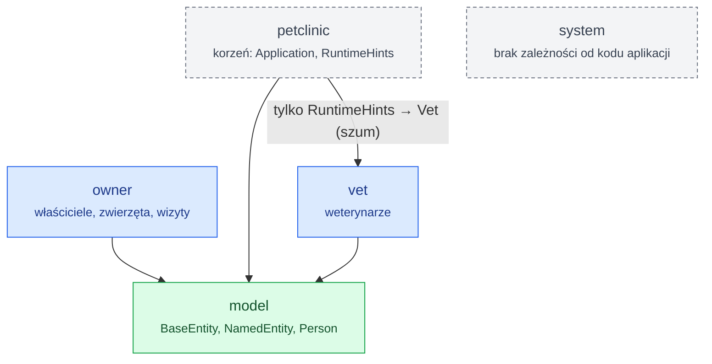
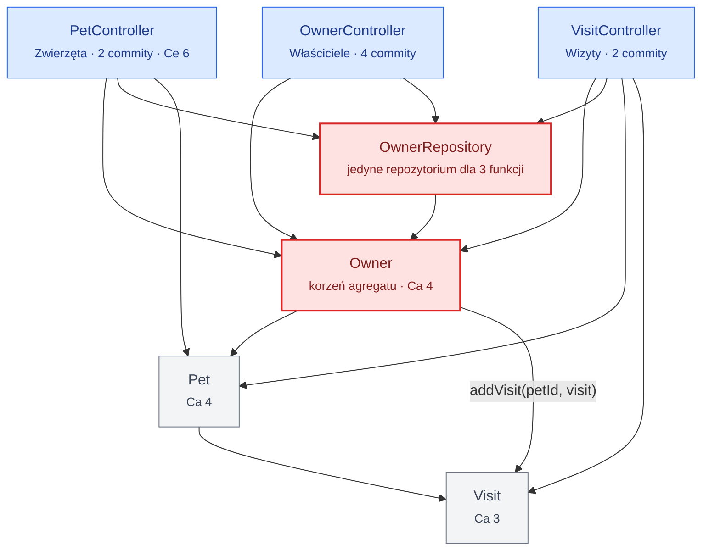

# Grafy zależności (Mermaid)

Graphviz nie jest zainstalowany (`dot -V`: `command not found`), więc zamiast SVG grafy są w Mermaid. Krawędzie wygenerował skrypt `dot-to-mermaid.mjs` z plików DOT jdeps. Ręcznie dodałem tylko etykiety, kolory i węzeł `system` bez krawędzi.

## 1. Pakiety aplikacji

Źródło: `package/classes.dot`. Polecenie:

```sh
node dot-to-mermaid.mjs package/classes.dot --extra system
```

Uwzględnione są tylko węzły z `org.springframework.samples.petclinic`. Nazwy są skrócone do ostatniego członu, a `petclinic` oznacza korzeń pakietu (`PetClinicApplication`, `PetClinicRuntimeHints`).



**Odczyt:** bez cykli i bez zależności między `owner` a `vet`. Wszystko prowadzi do `model`. `system` nie ma krawędzi, ale jest powiązany z resztą przez napisy (cache `"vets"`, `lang`, fragmenty szablonów), których jdeps nie widzi.

## 2. Pytanie: dlaczego zmiana w `Owner` albo `OwnerRepository` dotyka trzech funkcji naraz?

Najważniejszy wniosek z analizy: zwierzęta i wizyty nie mają własnych repozytoriów. Wszystkie trzy kontrolery ładują i zapisują dane przez `OwnerRepository` i agregat `Owner`. W tabeli metryk `Owner` i `Pet` to „środek grafu” (Ca 4, Ce 3), a `PetController` ma najwyższy Ce w aplikacji.

Źródło: `class-full/classes.dot` (zależności także wewnątrz pakietu). Polecenie:

```sh
node dot-to-mermaid.mjs class-full/classes.dot \
  --only OwnerController,PetController,VisitController,OwnerRepository,Owner,Pet,Visit
```

Pominięte klasy (`PetType`, `PetTypeRepository`, `PetTypeFormatter`, `PetValidator`, `model`) nie zmieniają odpowiedzi na to pytanie.



**Odpowiedź:**
- Każdy z trzech kontrolerów ma krawędź do `Owner` **i** do `OwnerRepository` (czerwone węzły).
- Nie ma `PetRepository` ani `VisitRepository`, więc zwierzę i wizyta zapisują się przez `owners.saveAndFlush(owner)` i kaskadę z `Owner`.
- Zmiana sygnatury, ładowania (EAGER) albo logiki `addPet` lub `addVisit` w `Owner` dotyka więc wszystkich trzech funkcji z raportu terytorium.
- Krawędź `Owner → Visit` to skrót przez agregat, z pominięciem `Pet`.

**Czego graf nie pokazuje:**
- kaskady JPA i fetch EAGER (zachowanie w runtime),
- reguły unikalności imienia, którą `PetController` dopasowuje do nazwy indeksu `unique_owner_pet_name` z trzech `schema.sql` przez napis,
- przekierowań `redirect:/owners/{id}` między kontrolerami.
