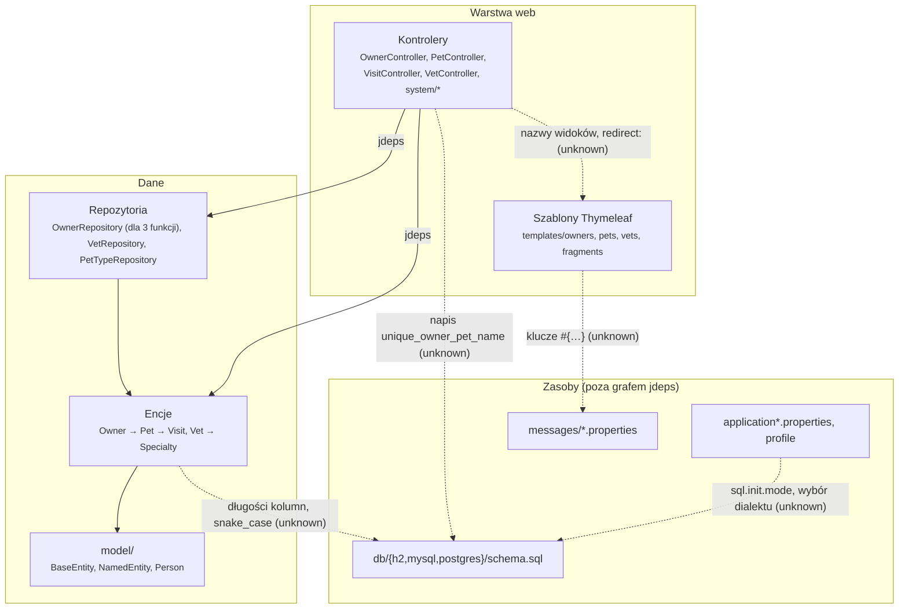

# Mapa repo: Spring PetClinic

Dokument onboardingowy. Łączy trzy artefakty: **T1** `artifact-1-territory.md` (gdzie toczy się praca), **T2** `artifact-2-structure.md` (jak kod jest powiązany) i **T3** `artifact-3-contributors.md` (kogo zapytać). Nazwy obszarów (A1–A8, P1, X1–X4) pochodzą z `areas.md`. Szczegóły i dowody są w artefaktach, a tutaj tylko wnioski.

Stan kodu: `ff2b1ec` (kod produktu bez zmian od `527d61b`). Okno historii: 2025-11-20 → 2026-11-20.

**Skąd wiem** (oznaczenie przy każdym sprzężeniu i sygnale):
- `[git]`: historia zmian w oknie (T1, T3),
- `[jdeps]`: graf zależności z bytecode'u Javy (T2),
- `[unknown]`: obszar, którego jdeps nie widzi (szablony, SQL, properties, profile, SCSS i zasoby statyczne, wiązania Springa w runtime). To **brak danych, a nie brak powiązań**,
- `[runtime]`: sprawdzone na uruchomionej aplikacji (T2 U36),
- `[JaCoCo]`: pokrycie testami (T2 §7),
- `[kod]`: przeczytane w kodzie przy pisaniu tej mapy.

---

## 1. TL;DR

PetClinic to przykładowa aplikacja Spring Boot 4.1 (Java 17, JPA, Thymeleaf), która działa na H2, MySQL i PostgreSQL. Funkcjonalnie to trzy rzeczy: właściciele ze zwierzętami i wizytami, lista weterynarzy i wspólny interfejs. **Połowa pracy w oknie (14 z 28 commitów po filtrach) dotyczy pakietu `owner/`.** Ten pakiet mieści trzy funkcje, które w kodzie mają jedną ścieżkę zapisu: agregat `Owner` i `OwnerRepository`. Graf typów jest czysty (0 cykli, `owner` i `vet` od siebie niezależne). **Ryzyko leży poza Javą:** w trzech plikach schematu, w regułach zapisanych jako napisy i w konfiguracji Springa, czyli tam, gdzie jdeps nic nie widzi. Jedyna regresja w oknie (`88e37c1`) przyszła właśnie z SQL. W 2026Q3 zewnętrzni kontrybutorzy masowo utwardzali dane wejściowe: każdy przypadek brzegowy poprawiała inna osoba, a od 2026-09-29 w kodzie produktu nie ma zmian. Te poprawki mają dziś testy, więc granice wejścia nie są już strefą ryzyka.

Linie ciągłe pochodzą z grafu jdeps. Przerywane to powiązania przez napisy i konfigurację: istnieją, ale żadne narzędzie z tej analizy ich nie zmierzyło.

---

## 2. Teren

### Duża odpowiedzialność a peryferia

| | Obszar | Gdzie | Aktywność `[git]` | Charakter |
|---|---|---|---|---|
| **Rdzeń** | Właściciele, zwierzęta, wizyty (A1–A3) | `owner/`, `templates/owners/`, `templates/pets/` | 14/28 commitów (8 / 7 / 3) | Głęboki: agregat, kaskada JPA, logika domenowa w kontrolerze |
| **Rdzeń, mało zmian** | Schemat baz (A6) | `src/main/resources/db/` | 4 | Duży zasięg skutków przy małym ruchu: trzy dialekty, wykonywany przy starcie |
| **Fundament** | Model wspólny (A5) | `model/` | 3 | Płytki i stabilny: dziedziczą z niego wszystkie encje |
| Peryferia | Weterynarze (A4) | `vet/`, `templates/vets/` | 3 | Płytki w grafie, ale z ukrytym runtime (cache, XML) |
| Peryferia | Interfejs wspólny i i18n (A7) | `system/`, `templates/fragments/`, `messages/` | 3 + 3 | W grafie wygląda na izolowany, a jest powiązany przez napisy |
| Peryferia | Start i obraz natywny (A8) | `PetClinicApplication`, `PetClinicRuntimeHints` | 2 (jedna fala w 2026Q2) | Hinty tylko dla buildu natywnego, którego CI nie uruchamia |
| Platforma | Build i testy integracyjne (P1) | `pom.xml`, `build.gradle`, `*IntegrationTests` | testy: 6, 3. miejsce | Ruch z upgrade'ów Bootu, a nie z produktu |

### Gdzie struktura pakietów nie odpowiada aktywności

- **Jeden pakiet, trzy funkcje, jedna ścieżka zapisu.** `owner/` mieści właścicieli, zwierzęta i wizyty. Nie ma `PetRepository` ani `VisitRepository`: wszystko zapisuje `owners.saveAndFlush(owner)` przez kaskadę `[jdeps]`. Na poziomie pakietu `owner` ma I = 1,00 (liść), co ukrywa, że wewnątrz ma środek grafu (`Owner` i `Pet`: Ca 4).
- **Najwyższy fan-in nie zmienia się, a aktywność jest w adapterach.** `PetType` ma Ca 5 i 0 commitów, a repozytoria nie miały zmian funkcjonalnych. Zmieniały się kontrolery: `OwnerController` 4 commity, `VetController` 3 `[jdeps]` + `[git]`.
- **Logika domenowa siedzi w kontrolerze.** Unikalność imienia zwierzęcia jest w `PetController` (Ce 6, najwyższe w aplikacji), a nie w `PetValidator` ani w `Pet` `[jdeps]` + `[git]`.
- **Pakiet testowy po nieistniejącej warstwie.** `service/ClinicServiceTests` testuje repozytoria, bo warstwy serwisowej nie ma.
- **`system` ma 0 krawędzi, ale nie jest izolowany.** Zmienia się razem z wizytami (`753d35c`: klucz i18n i komunikat w `inputField.html`) `[git]`, a wiążą go napisy: cache `"vets"`, `minVisitDate`, `?lang=` `[unknown]`.

### Aktywność w czasie `[git]`

| Kwartał | Nacisk | Kto |
|---|---|---|
| 2025Q4 | Platforma: Boot 4.0, Java 17, snake_case, usunięcie HSQLDB | maintainerzy |
| 2026Q1 | Utrzymanie: obrazy baz, `fetch size` | maintainerzy |
| 2026Q2 | Początek walidacji (`Person`, data wizyty), binder, Boot 4.1, hinty natywne | mieszanie |
| **2026Q3** | **Szczyt:** unikalne imię zwierzęcia, limity długości pól, paginacja i overflow, nowe języki | prawie wyłącznie zewnętrzni |
| 2026Q4 | Cisza: od 2026-09-29 brak zmian w kodzie produktu | – |

Trend: nacisk przesunął się z platformy na odporność formularzy w `owner/`. Liczby są małe (0–5 na komórkę), więc etykiety „rosnący” dla wizyt, `vet/` i i18n opierają się na 1–2 commitach.

---

## 3. Realne powiązania

### Warstwy i cykle

- Kierunek jest zawsze kontroler → repozytorium → encja → `model`. **Cykli: 0** na poziomie pakietów, klas main i klas testów `[jdeps]`.
- Relacje encji są jednokierunkowe (`Owner→Pet→Visit`, bez `mappedBy`; `Pet` nie zna `Owner`) `[jdeps]` + `[kod]`.
- Pętle istnieją, ale poza grafem `[unknown]`:
  - `redirect:/owners/{id}` z `PetController` i `VisitController` do `OwnerController`,
  - klucz obcy `pets.owner_id`, odwrotny do kolekcji w Javie.
- **Ryzyko na przyszłość:** reguła o zwierzęciu, która potrzebuje kontekstu właściciela, kusi, żeby dodać `@ManyToOne Owner`. To byłby pierwszy cykl JPA.

### Co naprawdę zmienia się razem

| Sprzężenie | Skąd wiem | Rodzaj |
|---|---|---|
| 3 kontrolery `owner/` → `Owner` + `OwnerRepository` | `[jdeps]`; zmiany `Owner` w oknie nie dotknęły kontrolerów, bo kontrakt się nie zmienił `[git]` | strukturalne, ręczne |
| Właściciele + zwierzęta (3 wspólne commity, jedyna powtarzalna para) | `[git]`. Przez krawędź grafu przechodzi tylko 1 z 3 (`fd4361b`), pozostałe to wspólny binder i `addPet` | ręczne |
| Kod `owner/` + jego testy (7 z 10 zmian kodu przyszło z testem) | `[git]` | ręczne, zdrowe. Testy `@WebMvcTest` mockują `OwnerRepository`, więc zmiana kontraktu `Owner` pociąga za sobą poprawki mocków w 3 klasach testów: **sprzężenie przez mock**, tanie |
| Paginacja w `OwnerController` i `VetController` (3 poprawki zawsze w obu) | `[git]`, **bez krawędzi** `[jdeps]` | duplikacja kodu, a nie zależność |
| Binder `setDisallowedFields("id", "*.id")` w 3 kontrolerach | `[git]` (`c7ee170`), `[kod]` | wspólny wzorzec, bez zależności |
| `PetController` ↔ nazwa ograniczenia `unique_owner_pet_name` w SQL | `[unknown]` (napis), `[git]` (`e0db9b1`) | ręczne. Patrz strefa 3 |
| Trzy dialekty `schema.sql` | `[git]`: razem tylko w 1 z 2 zmian schematu; `[unknown]` | **oczekiwane, ale niczym niewymuszone** |
| Wizyty + i18n + `fragments/inputField.html` (`minVisitDate`) | `[git]` (`753d35c`), `[unknown]` (atrybut modelu jako napis) | ręczne |
| `application.properties` → wszystkie encje (snake_case, `batch_fetch_size`) | `[git]`, `[unknown]` | jeden plik, globalny zasięg |
| Kontrolery ↔ szablony (nazwy widoków, `redirect:`), szablony ↔ `messages*.properties`, zapytania Spring Data z nazw metod | `[unknown]` | jdeps tego nie mierzy |
| Wrappery Gradle/Mavena + podbicie wersji (`9a5d50c`) | `[git]` | **przez regenerację** (`./gradlew wrapper`): tanie, bez związku z produktem |
| `petclinic.css` ↔ `src/main/scss/` | odfiltrowane w T1 jako plik generowany | **przez regenerację** (`./mvnw package -P css`); w Gradle tego kroku nie ma (U34) |

### Ścieżka zmiany na przykładzie: nowe pole w formularzu wizyty `[kod]`

Sprawdzone w kodzie 2026-11-23. Pokazuje, ile miejsc łączy jedno pole, choć graf widzi z nich tylko dwa. Ścieżki Java są pod `owner/`, a zasoby pod `src/main/resources/`.

| Miejsce | Co tam jest dziś | Co zrobić przy nowym polu |
|---|---|---|
| `owner/Visit.java` | `date` (`@Column(name = "visit_date")`) i `description` (`@NotBlank @Size(max = 255)`). Konstruktor ustawia datę na jutro | pole z walidacją. `@Size` musi być równy kolumnie (`AGENTS.md`) |
| `owner/VisitController.java` | binder blokuje tylko `id` i `*.id`, więc nowe pole zwiąże się samo. `@ModelAttribute` tworzy wizytę przez `pet.addVisit`, a zapis idzie przez `owner.addVisit(petId, visit)` → `owners.save(owner)` (strefa 2) | zwykle nic. Reguły między polami dopisuje się ręcznie, tak jak sprawdzenie daty (`rejectValue("date", …)`) |
| `templates/pets/createOrUpdateVisitForm.html` | pola przez `fragments/inputField :: input (…)`. Pod formularzem jest tabela poprzednich wizyt | pole w formularzu i kolumna w tabeli |
| `templates/owners/ownerDetails.html` | druga lista wizyt (data i opis) w szczegółach właściciela | kolumna, jeśli pole ma być widoczne |
| `templates/fragments/inputField.html` | wspólny fragment pól, obsługuje typy `text` i `date` (`minVisitDate`) | zmiana tylko przy nowym typie pola, a dotyczy wtedy **wszystkich** formularzy |
| `messages.properties` i każdy `messages_*.properties` | etykiety i komunikaty | nowe klucze we wszystkich plikach (`I18nPropertiesSyncTest`) |
| `db/{h2,mysql,postgres}/schema.sql` | tabela `visits`: w H2 i MySQL `description VARCHAR(255)`, w Postgresie `TEXT` (bez limitu) | kolumna w trzech plikach |
| `db/{h2,mysql}/data.sql` | **`INSERT INTO visits VALUES (…)` bez listy kolumn**, w MySQL `INSERT IGNORE`. Postgres podaje listę kolumn | dopisać wartość we wszystkich wierszach H2 i MySQL, bo inaczej start padnie na liczbie kolumn. Postgres wymaga zmiany tylko przy kolumnie `NOT NULL` bez wartości domyślnej |
| `owner/VisitControllerTests` | 5 testów `@WebMvcTest` z mockiem `OwnerRepository` (sukces, błędy, data nie w przyszłości, opis 256 znaków) | test granicy nowego pola |
| `service/ClinicServiceTests` | `shouldAddNewVisitForPet` i `shouldFindVisitsByPetId`: zapis i odczyt wizyty na prawdziwej bazie, tylko H2 | jedyne miejsce, gdzie test sprawdza, że pole trafia do bazy |

`VisitController` ma 6/8 pokrytych gałęzi `[JaCoCo]`.

**Istniejące bazy nie dostaną nowej kolumny.** W projekcie nie ma narzędzia do migracji (Flyway, Liquibase), a `ddl-auto=none`. H2 robi `DROP` i `CREATE` przy każdym starcie, więc tam wszystko zadziała. MySQL i Postgres mają `CREATE TABLE IF NOT EXISTS`, więc istniejąca tabela `visits` zostaje bez nowej kolumny. Hibernate wtedy padnie dopiero na pierwszym zapytaniu o wizyty, a nie przy starcie `[kod]`, nieodtworzone.
- `docker-compose.yml` nie montuje wolumenu na dane baz. Dane przeżyją jednak restart tego samego kontenera, bo obraz bazy trzyma je w wolumenie anonimowym. Czysty start daje `docker compose down -v`.
- Projekt nie ma ustalonego sposobu migracji baz, które już istnieją poza kontenerem. To decyzja do uzgodnienia z maintainerami.

---

## 4. Strefy ryzyka

Każdą strefę wspierają co najmniej dwa niezależne sygnały. Jedną przyczynę liczę raz: regresja `88e37c1` jest w strefie 1, a nie także w 3.

**Weryfikacja z dzisiejszym kodem (2026-11-23, stan `ff2b1ec`, tylko odczyt).** Każda strefa ma status:
- ✅ potwierdzona w dzisiejszym kodzie,
- 🕓 tylko ślad w historii: usunięta ze stref i opisana w „Ograniczeniach”,
- ❓ niewiadoma: przeniesiona do niewiadomych w „Ograniczeniach”.

Z pięciu stref zostały cztery. Dawna strefa 4 (granice danych wejściowych) ma status 🕓. Sygnały oznaczone jako „naprawione” zostały w strefie jako kontekst, ale nie liczę ich do minimum dwóch.

**1. Zgodność baz danych (H2, MySQL, PostgreSQL)** ✅
*Gdzie:* `src/main/resources/db/{h2,mysql,postgres}/schema.sql`, `application-{mysql,postgres}.properties`
*Dlaczego:* schemat żyje w trzech ręcznie synchronizowanych plikach, a na MySQL i Postgresie wykonuje się przy każdym starcie (`sql.init.mode=always`).
- Dziś: obie linie `spring.sql.init.mode=always` nadal są w `application-{mysql,postgres}.properties`, a schemat nadal jest w trzech osobnych plikach `[kod]`.
- Dziś: testy MySQL i Postgresa mają po dwa przypadki (`findAll`, `ownerDetails`). Żaden test nie uruchamia aplikacji dwa razy na tej samej bazie `[kod]`.
- Obszar jest w całości niewidoczny dla grafu `[unknown]`.
- Historia: 50% commitów w obszarze to poprawki, a dialekty zmieniły się razem tylko raz `[git]`.
- Naprawione: jedyna regresja w oknie (`e0db9b1` → `88e37c1`) jest zamknięta. `88e37c1` to ostatnia zmiana w `db/`, a dziś cały DDL Postgresa ma `IF NOT EXISTS`. Skrypty z danymi są idempotentne: MySQL używa `INSERT IGNORE`, Postgres `WHERE NOT EXISTS` `[kod]`. Ryzyko polega na ręcznej synchronizacji trzech plików i braku testu powtórnego startu, a nie na tym konkretnym błędzie.

**2. Właściciele, zwierzęta i wizyty: zapis przez agregat `Owner`** ✅
*Gdzie:* `owner/Owner.java`, `owner/OwnerRepository.java`, `owner/{Owner,Pet,Visit}Controller.java`
*Dlaczego:* trzy funkcje produktu mają jedną ścieżkę zapisu, więc zmiana w `addPet`, `addVisit`, `getPet` albo w ładowaniu dotyka wszystkich trzech.
- Dziś: nie ma `PetRepository` ani `VisitRepository`. Trzy kontrolery zapisują przez `OwnerRepository` (`save` albo `saveAndFlush`), a `Owner.pets` ma `cascade = ALL, fetch = EAGER` `[kod]` + `[jdeps]` (Ca 4).
- Dziś: `Owner` ma 20/28 pokrytych gałęzi `[JaCoCo]`. Od pomiaru `Owner.java` się nie zmienił, ostatnia zmiana to `3c7ab98`.
- Dziś: w `@WebMvcTest` repozytorium jest mockiem (`@MockitoBean`). Kaskadę na prawdziwej bazie sprawdza tylko `service/ClinicServiceTests` (`shouldInsertPetIntoDatabaseAndGenerateId`, `shouldAddNewVisitForPet`) i tylko na H2 `[kod]`. Poprawka do T2 §7 #3: kaskada nie jest wyłącznie mockowana.
- Historia: 14 z 28 commitów w oknie `[git]`.
- Naprawione: błąd `676db04` (zdublowane zwierzę przez `isNew()`) jest zamknięty w tym samym commicie, który dodał `owner/OwnerTests` (`addPetAddsPersistedPet`, `addPetDoesNotAddDuplicatePet`) `[git]` + `[kod]`.

**3. Unikalne imię zwierzęcia u właściciela** ✅
*Gdzie:* `owner/PetController.java` (`isDuplicatePetNameViolation`), ograniczenie unikalności w trzech `schema.sql`, `PetClinicConcurrencyTests`
*Dlaczego:* reguła domenowa rozpoznaje naruszenie po fragmencie komunikatu bazy, czyli po napisie.
- Dziś: `isDuplicatePetNameViolation` sprawdza `message.toLowerCase().contains("unique_owner_pet_name")` (`PetController.java:204`). Od `e0db9b1` nikt tego nie zmieniał `[kod]` + `[git]`.
- Dziś: nazwę `unique_owner_pet_name` mają tylko H2 (`ALTER TABLE … ADD CONSTRAINT`) i Postgres (`CREATE UNIQUE INDEX`). W `db/mysql/schema.sql` jest nienazwane `UNIQUE (owner_id, name)` `[kod]`. T2 §1.5 pisze o napisie „z trzech `schema.sql`”, ale w rzeczywistości są dwa.
- Dziś: testy nie łączą napisu z prawdziwą bazą. `PetControllerTests` podaje wymyślony komunikat (`"Duplicate key: unique_owner_pet_name"`). `ClinicServiceTests.shouldFailToInsertDuplicatePetNameForSameOwner` sprawdza tylko typ wyjątku, a nie nazwę ograniczenia. `PetClinicConcurrencyTests` działa na domyślnym H2 `[kod]`.
- Dziś: każdy dialekt ignoruje wielkość liter inaczej: Postgres przez indeks na `LOWER(name)`, H2 przez typ `VARCHAR_IGNORECASE`, a MySQL przez collation bazy `utf8_general_ci` ustawianą w `db/mysql/user.sql`, a nie w `schema.sql` `[kod]`. Ta sama reguła ma więc trzy różne implementacje.
- `PetController` ma najwyższe Ce (6) `[jdeps]` i 28/38 pokrytych gałęzi `[JaCoCo]`. Regułę zna jedna osoba `[git]`, T3.
- Skutek na MySQL (czy równoczesny duplikat kończy się błędem 500) jest **niewiadomą** i opisuję go w „Ograniczeniach”. Sama rozbieżność nazw jest faktem w kodzie.

**4. Weterynarze: cache** ✅
*Gdzie:* `vet/VetRepository.java` (`@Cacheable("vets")`), `system/CacheConfiguration.java`
*Dlaczego:* konfiguracja cache w kodzie nie działa, a testy tego nie wychwytują.
- Dziś: `CacheConfiguration` nadal rejestruje tylko `JCacheManagerCustomizer` (statystyki przez JCache). Caffeine jest na classpath w obu buildach i plik od `3aa79e3` (2025-09-01) się nie zmienił, więc wynik z działającej aplikacji jest nadal aktualny: działa `CaffeineCacheManager`, customizer się nie wykonuje, a cache `vets` powstaje dynamicznie, bez statystyk i limitu `[kod]` + `[runtime]` + `[JaCoCo]`.
- Dziś: cache jest „testowany” tylko komentarzem `// served from cache` w trzech testach integracyjnych. Żaden test nie sprawdza cache ani jego konfiguracji `[kod]`.
- Nie ma aktywnej osoby, która zna ten fragment (T3). Aktywność jest mała, więc to ryzyko ukryte, a nie gorący punkt.
- Odpowiedź XML z `/vets` była tu wcześniej sygnałem. Dziś jest niewiadomą (patrz „Ograniczenia”), więc ją z tej strefy wyjąłem.

### Wygląda groźnie, ale nie jest

| Sygnał | Dlaczego to fałszywy alarm |
|---|---|
| `pom.xml`: najczęściej zmieniany plik (10 commitów), łączy 9 obszarów, oba reverty w oknie | Jedna przyczyna, czyli podbicia wersji. 7 z 9 połączeń pochodzi z 2 szerokich commitów (Boot 4.0, zależności). Reverty cofały zbyt świeże podbicie checkstyle i flagę `--release 17`, a nie funkcje. Współzmiany `pom.xml` i `build.gradle` wymusza reguła projektu. |
| Testy integracyjne na 3. miejscu aktywności | Połowa to upgrade'y Bootu i obrazów baz (ta sama przyczyna co wyżej), reszta to konfiguracja. |
| `PetClinicRuntimeHints → Vet, Person, BaseEntity`; pakiet `vet` Ca 1; 0% pokrycia | Literały klas w hintach to szum dla metryk. 0% wynika z tego, że hinty działają tylko w buildzie natywnym. Prawdziwa uwaga: buildu natywnego nikt nie sprawdza w CI, a hint `mysql-default-conf` wskazuje nieistniejący plik (U28). |
| `model` Ca 7, `PetType` Ca 5 | Zależność przez dziedziczenie po klasach bazowych encji i stabilny słownik. Oba mają mało commitów. Długości kolumn w `model` to dziś tylko ślad w historii (patrz „Ograniczenia”). |
| `PetController` zmieniał się razem z 5 obszarami | Wynika z dwóch commitów: jednego feature'u (`e0db9b1`) i jednej linijki bindera (`c7ee170`). |
| `system/*` i `PetClinicApplication`: Ca 0, Ce 0 | Klasy konfiguracji i klasa aplikacji: wiąże je skanowanie komponentów, nie typy. Uwaga: zero znaczy „niewidoczne”, a nie „bezpieczne” (patrz strefa 4). |
| `Ca_test = 0` dla kontrolerów | `@WebMvcTest(X.class)` to wartość adnotacji, a nie krawędź. Testy istnieją, a pokrycie kontrolerów wynosi 94–100% `[JaCoCo]`. |
| Współzmiana wrapperów Gradle/Mavena | Regeneracja przy podbiciu wersji. |

---

## 5. Kogo zapytać

🟢 ostatni commit ≤ 6 mies. temu, 🟡 6–12 mies. Repo nie ma CODEOWNERS. Dave Syer (🟡 jako autor) był committerem wszystkich zewnętrznych zmian z 2026, więc jest domyślnym punktem odniesienia wszędzie.

| Strefa | Pierwszy wybór | Drugi wybór |
|---|---|---|
| 1. Zgodność baz | Michael Popov 🟢: idempotentność DDL na Postgresie (`88e37c1`) | Dave Syer 🟡: skrypty MySQL, idempotentne dane Postgresa |
| 2. Agregat `Owner` | Zaid1681 🟢: `addPet` i `isNew()` (`676db04`) | Dave Syer 🟡: autor modelu agregatu (`83ff9a5`) i bindera |
| 3. Unikalne imię | Shivram 🟢: autor reguły (`e0db9b1`), jedyna osoba, która zna ją całą | sumituppal03 🟢: przypadki brzegowe edycji (`b3ee2c5`, `b11afec`) |
| 4. Cache weterynarzy | nikt aktywny w tym temacie; najbliżej Dave Syer 🟡 | Pedro Arthur Hartmann 🟢 (tylko `VetController`) |
| Wizyty (poza strefami) | shivam tiwari 🟢: data wizyty i `minVisitDate` (`753d35c`) | Ayush Keshri 🟢: długość opisu (`f3c7483`); zapasowo Dave Syer 🟡 (binder `c7ee170`) |
| Build (poza strefami) | Patrick Baumgartner 🟢: Boot 4.0/4.1, Gradle | Stéphane Nicoll 🟡 |
| Granice wejścia (poza strefami, ślad w historii) | Pedro Arthur Hartmann 🟢: paginacja i overflow w obu kontrolerach | Rennan Ballaro Gomes de Sousa 🟢: `@Size` ↔ kolumny (`3c7ab98`) |

Wiedza o przypadkach brzegowych jest jednorazowa: większość osób z tabeli ma 1–3 commity w repo. Daty pochodzą z gita i nie mówią, czy ktoś jest dziś dostępny.

---

## 6. Pierwszy dzień

Kolejność od zasad do miejsc, w których najłatwiej coś zepsuć. Ścieżki Java są pod `src/main/java/org/springframework/samples/petclinic/`.

1. **`AGENTS.md`**: twarde reguły (schemat w 3 plikach, i18n we wszystkich `messages_*`, `@Size` = kolumna, DCO, format). Większość błędów z okna to łamanie tych reguł.
2. **`owner/Owner.java`**: agregat, przez który zapisują się trzy funkcje. Zwróć uwagę na `addPet`, `addVisit`, `getPet` i `isNew()`.
3. **`owner/OwnerController.java`**: typowy kontroler: binder, paginacja z clampem i redirectem, `strip()` nazwiska. Bliźniak paginacji jest w `vet/VetController.java`.
4. **`owner/PetController.java`**: logika domenowa w kontrolerze: sprawdzenie duplikatu, obsługa `DataIntegrityViolationException` po napisie, `PetValidator`.
5. **`src/main/resources/db/postgres/schema.sql`**, czytany obok `db/h2/schema.sql` i `db/mysql/schema.sql`: porównaj ograniczenie `unique_owner_pet_name` i długości kolumn. Do tego `application-postgres.properties` (`sql.init.mode=always`).
6. **`model/Person.java`** i **`model/NamedEntity.java`**: wspólne kontrakty encji. `Person` ma `@Size(30)`, a `NamedEntity` nie ma limitu.
7. **`src/main/resources/templates/fragments/inputField.html`**: wspólny fragment formularzy. Pokazuje, jak szablony wiążą się z kontrolerami przez napisy (`minVisitDate`).
8. **`system/CacheConfiguration.java`** z `vet/VetRepository.java`: przykład konfiguracji, która kompiluje się i ładuje, ale w runtime nie działa (U36).

Wszystkie ścieżki sprawdzone w repo 2026-11-23.

---

## 7. Ograniczenia

- **To mapa aktywności i struktury w oknie 1 roku** (2025-11-20 → 2026-11-20), a nie pełna historia projektu. Po filtrach zostaje 28 commitów, lider ma 8, a od 5. miejsca w rankingu są w praktyce remisy. Jeden commit zmienia udział o 12–33 punkty procentowe.
- **Tylko historia gita.** Mapa nie uwzględnia PR-ów, issue, recenzji ani zgłoszeń odrzuconych. „Cisza” w 2026Q4 znaczy tylko tyle, że nic nie zostało przyjęte.
- **jdeps widzi wyłącznie bytecode Javy.** Szablony Thymeleaf, SQL, properties i profile, SCSS i zasoby statyczne oraz wiązania Springa w runtime (DI, proxy, cache, zapytania Spring Data z nazw metod) nie mają grafu. Są oznaczone jako `[unknown]`, pełna lista to U1–U36 w `evidence/jdeps/unknowns.md`.
- **Pokrycie JaCoCo (94% linii, 82% gałęzi) mierzy wykonanie, a nie asercje.** Klasa ładowana przez kontekst Springa może być „pokryta” bez żadnego testu zachowania.
- **Osoby i wiedza:** `blame` mierzy przetrwałe linie, a nie zrozumienie kodu. Tożsamości bez `.mailmap` łączono ręcznie i ostrożnie (np. `king-407` i shivam tiwari są osobno). Commity AI rozpoznawano tylko po trailerze `Co-Authored-By`.
- **Mapa nie mówi:**
  - jak aplikacja zachowuje się pod obciążeniem ani w produkcji,
  - czy build natywny działa (nie był uruchamiany),
  - czy build Gradle zachowuje się jak Maven (porównano tylko pliki),
  - czy dawne decyzje (agregat z 2016, `sql.init.mode`) są nadal intencją maintainerów,
  - kto formalnie odpowiada za obszar (nikt tego nie zapisał).
- **Wnioski bez odtworzenia:** przyczyna regresji `88e37c1` (dziś naprawiona) i brak nowej kolumny w istniejących bazach MySQL i Postgres (patrz „Ścieżka zmiany” w sekcji 3) wynikają z kodu i konfiguracji. Nie uruchamiano ich na prawdziwej bazie.
- **Zdjęte ze stref ryzyka: tylko ślad w historii** (weryfikacja 2026-11-23):
  - *Granice danych wejściowych (dawna strefa 4).* Seria poprawek z 2026 jest domknięta:
    - `@Size` w `Person`: `3c06fbf`,
    - limit imienia zwierzęcia w `PetValidator`: `676db04`,
    - opis wizyty: `f3c7483`,
    - miasto i adres właściciela: `3c7ab98`,
    - overflow i redirect paginacji w obu kontrolerach: `b33136f`, `0d064b0`, `500158f`,
    - spacje w wyszukiwaniu: `bb37aad`.

    `500158f` (2026-09-29) zamyka serię. Dziś limity pól wpisywanych przez użytkownika zgadzają się z kolumnami: `Person` 30, `Owner.address` 255, `Owner.city` 80, `Visit.description` 255, imię zwierzęcia 30. Granice mają testy: `OwnerControllerTests` (miasto 81 i adres 256 znaków, paginacja poza zakresem), `PetValidatorTests` (31 znaków), `VisitControllerTests` (256 znaków), `VetControllerTests` (paginacja). Uwaga do T2 §7 #5: nie ma testu, który porównuje `@Size` z `schema.sql`, ale granice są testowane od strony formularzy. Nadal nikt nie wymusza reguły dla **nowych** pól, a `NamedEntity` nie ma `@Size`. Typy zwierząt i specjalizacje nie mają jednak formularza, więc dziś to nie jest ryzyko.
- **Niewiadome** (nie rozstrzyga ich sam odczyt kodu):
  - *MySQL a duplikat imienia (strefa 3):* czy przy równoczesnym zapisie komunikat błędu MySQL zawiera napis `unique_owner_pet_name`. Ograniczenie nie ma nazwy, więc najpewniej nie zawiera, a wtedy `PetController` rzuca wyjątek dalej i użytkownik dostaje stronę błędu. *Jak sprawdzić:* uruchomić `PetClinicConcurrencyTests` z profilem `mysql` (Testcontainers i Docker) albo `docker compose up mysql`, potem `spring.profiles.active=mysql` i dwa równoczesne `POST /owners/1/pets/new` z tym samym imieniem. Odpowiedź z formularzem i błędem „already in use” obala ryzyko, a strona błędu je potwierdza.
  - *XML z `/vets` (dawniej w strefie cache):* `Vets` ma adnotacje JAXB, ale w `pom.xml` i `build.gradle` jest tylko `jakarta.xml.bind-api`, bez implementacji JAXB i bez `jackson-dataformat-xml`. Nie wiadomo, czy `/vets` w ogóle zwraca XML. `VetControllerTests` sprawdza tylko JSON. *Jak sprawdzić:* uruchomić aplikację i wywołać `curl -H "Accept: application/xml" localhost:8080/vets`. Odpowiedź 406 oznacza, że XML nie działa, a 200 z XML, że działa i tylko nie ma testu.
